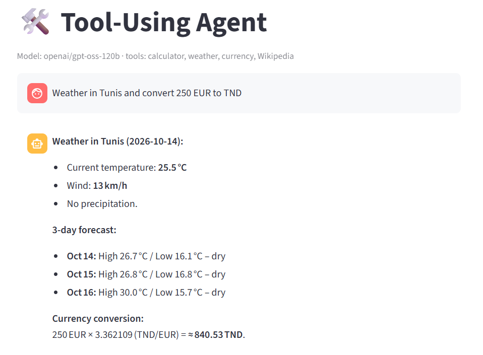
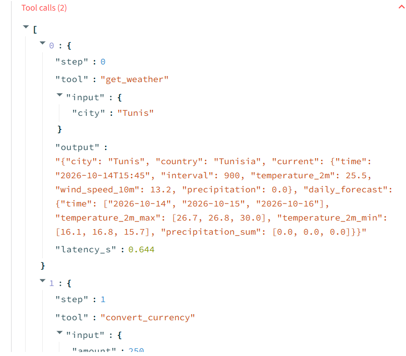

# Tool-Using Agent (from scratch, free LLM API)

A small LLM agent that decides **when and which tools to call** (calculator, live weather,
live currency rates, Wikipedia). It is built on any **OpenAI-compatible endpoint** with **no agent
framework**, so every part of the loop is visible and testable. It runs on free tiers (Groq, Gemini)
or fully locally (Ollama).

| Conversation | Tool calls (what the agent did) |
|---|---|
|  |  |

## Why this project
- Implements the core agent loop by hand: model → tool call → execute → tool result → model.
- Provider-agnostic: swap Groq / Gemini / Ollama by changing three environment variables.
- Tool errors are returned to the model as data, so it can recover or report honestly.
- Includes an **evaluation harness** (`eval.py`) that measures tool selection, including
  cases where *no* tool should be used and cases where a tool fails.
- The Streamlit UI exposes each tool call (input, output, latency); every run is saved as a JSON trace.

## Run it
```bash
python -m venv .venv
.venv\Scripts\activate          # Windows (macOS/Linux: source .venv/bin/activate)
pip install -r requirements.txt
copy .env.example .env          # macOS/Linux: cp .env.example .env
streamlit run app.py
python eval.py                  # writes eval_results.csv
```
Edit `.env` and set your free API key (Groq: console.groq.com/keys). Recommended model on Groq:
`LLM_MODEL=openai/gpt-oss-120b`.

## Structure
| File | Role |
|---|---|
| `tools.py` | Tool functions + JSON schemas (safe AST calculator, Open-Meteo, open.er-api, Wikipedia) |
| `agent.py` | Agent loop with step limit, 429 retry and trace logging |
| `app.py` | Streamlit chat UI with tool-call inspector |
| `eval.py` | 12 test cases + tool-selection report (exact match, missing tools, extra tools) |

## Results

Evaluated on 12 hand-written test cases: single-tool questions, multi-tool questions,
questions that need **no** tool, an unknown city (tool error), and a French-language query.
A case passes only if the set of tools called exactly matches the expected set.
Model: `openai/gpt-oss-120b` on the Groq free tier, October 2026.

| Run | Exact match | Cases with a missing tool | Cases with an extra tool |
|---|---|---|---|
| Run 1 (before the metric was split) | 92% (11/12) | n/a | n/a |
| Runs 2–4 (same prompt, later) | 83%, 83%, 83% (10/12) | 1 | 1 |

### Stable failures
- **"What is the capital of Tunisia?"** (expected: no tool). The model calls `search_wikipedia`
  (one call returned an error), then answers correctly from its own knowledge. The answer is
  right, but the tool call is unnecessary.
- **"Weather in Qwxzyland?"** (expected: `get_weather`). In runs 2–4 the model answered without
  calling any tool, treating the name as fictional. This case sits on a decision boundary: it
  passed in run 1.

### Other observations
- On "What's the weather in Tunis right now?" the model answered in **Korean** to an English
  question. The tool-selection metric cannot see this, so a language check is needed.
- The same prompt and model scored 92% once and 83% three times, so results on a hosted free
  model are **not perfectly reproducible** between sessions.

### Limitations
- Small test set: one case moves the score by about 8 points.
- Measures tool selection only, not answer correctness or answer language.
- Free-tier models are retired over time (an earlier default, Llama 3.3 70B, was shut down),
  so results depend on the date they were run.

## Possible extensions
- Compare several free models (e.g. `qwen/qwen3.6-27b`) on the same eval set.
- Add a language check and an LLM-as-judge for answer correctness.
- Proactive behaviour: a background watcher that notifies the user when a condition is met
  (e.g. EUR/TND above a threshold).
- Memory across sessions, parallel tool calls.